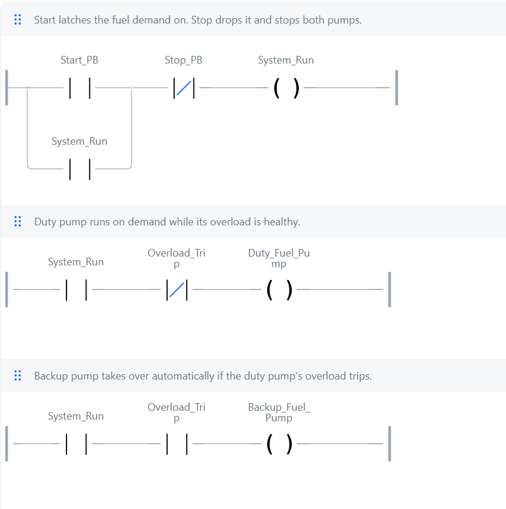

# 02: Duty/standby pump

**Shows:** automatic changeover from a duty pump to a standby pump when the duty pump's overload trips.

## Brief

A duty fuel pump on a Start/Stop latch, with an overload trip input. If the overload trips while the system is running, the duty pump stops and the backup pump starts automatically. Stop stops both.

## I/O list

| Tag | Type | Address | Description |
|---|---|---|---|
| Start_PB | Input | %IX1.0 | Pump start button, TRUE when pressed |
| Stop_PB | Input | %IX1.1 | Pump stop button, TRUE when pressed |
| Overload_Trip | Input | %IX1.2 | Duty pump overload, TRUE when tripped |
| Duty_Fuel_Pump | Output | %QX1.0 | Duty (main) fuel pump contactor |
| Backup_Fuel_Pump | Output | %QX1.1 | Backup fuel pump contactor |
| System_Run | Memory | none | Fuel demand. Latched by Start_PB, dropped by Stop_PB |

## Ladder



Rung comments:

1. Start latches the fuel demand on. Stop drops it and stops both pumps.
2. Duty pump runs on demand while its overload is healthy.
3. Backup pump takes over automatically if the duty pump's overload trips.

## Logic as structured text

```
System_Run       := NOT Stop_PB AND (Start_PB OR System_Run);
Duty_Fuel_Pump   := NOT Overload_Trip AND System_Run;
Backup_Fuel_Pump := Overload_Trip AND System_Run;
```

## Design notes

- The demand bit (`System_Run`) is what makes this work. Without it, the backup pump would run whenever the overload was tripped, even if nobody had asked for fuel. The program has to remember that the operator pressed Start.
- **Recovery is automatic.** When the overload clears, the duty pump takes back over and the backup stops. Real plant often needs a manual reset after an overload trip instead, so a fault isn't hidden. That would be the next upgrade: latch the trip and add a fault reset button.

## Test record

Tested in the OpenPLC simulator.

| # | Action | Expected | Result |
|---|---|---|---|
| 1 | Overload_Trip TRUE, nothing pressed | Neither pump runs | Pass |
| 2 | Press Start_PB | Duty pump runs, backup off | Pass |
| 3 | Set Overload_Trip TRUE while running | Duty pump stops, backup starts | Pass |
| 4 | Clear Overload_Trip | Duty pump takes back over, backup stops | Pass |
| 5 | Press Stop_PB with the duty pump running, then with the backup running | Both pumps off, and they stay off | Pass |
