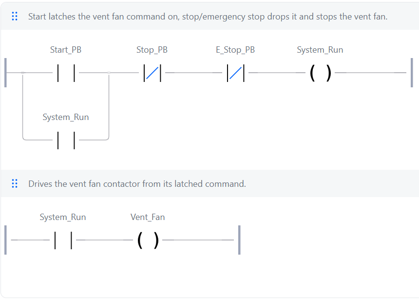

# 03: Emergency stop with manual reset

**Shows:** an emergency stop that drops the run latch, so releasing the E-stop doesn't restart the plant.

## Brief

A ventilation fan on a Start/Stop latch, plus an emergency stop.

- The E-stop stops the fan at once.
- Releasing the E-stop must not restart the fan. Start has to be pressed again.
- Start does nothing while the E-stop is held.

## I/O list

| Tag | Type | Address | Description |
|---|---|---|---|
| Start_PB | Input | %IX2.0 | Start button, TRUE when pressed |
| Stop_PB | Input | %IX2.1 | Stop button, TRUE when pressed |
| E_Stop_PB | Input | %IX2.2 | Emergency stop button, TRUE when pressed |
| Vent_Fan | Output | %QX2.0 | Vent fan contactor |
| System_Run | Memory | none | Fan run command. Latched by Start_PB, dropped by Stop_PB or E_Stop_PB |

## Ladder



Rung comments:

1. Start latches the vent fan command on. Stop or the emergency stop drops it and stops the vent fan.
2. Drives the vent fan contactor from its latched command.

## Logic as structured text

```
System_Run := NOT E_Stop_PB AND NOT Stop_PB AND (Start_PB OR System_Run);
Vent_Fan   := System_Run;
```

## Design notes

- The E-stop sits **in the latch rung**, not just on the output. Pressing it drops `System_Run`, which removes the seal-in. When the E-stop is released, nothing is holding the fan on, so only a fresh press of Start can restart it.
- If the E-stop only switched the output off, the latch would still be holding underneath, and the fan would restart the moment the E-stop was released. That's the failure this program is built to avoid.
- An E-stop in the PLC program is the control side only. On real plant the E-stop also has a hard-wired safety circuit that doesn't depend on the PLC.

## Test record

Tested in the OpenPLC simulator.

| # | Action | Expected | Result |
|---|---|---|---|
| 1 | Press Start_PB | Fan runs and stays running | Pass |
| 2 | Press E_Stop_PB | Fan stops at once | Pass |
| 3 | Release E_Stop_PB | Fan stays off | Pass |
| 4 | Press Start_PB | Fan runs again | Pass |
| 5 | Hold E_Stop_PB, press Start_PB | Fan will not start | Pass |
| 6 | Press Stop_PB while running | Fan stops, and stays off | Pass |
