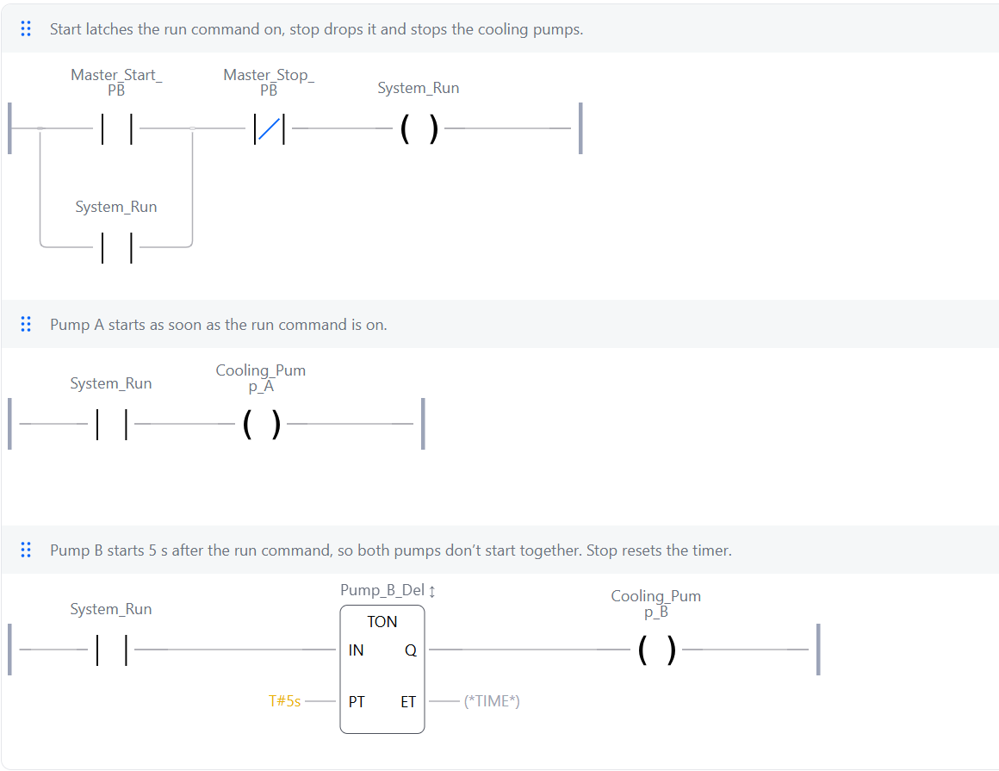

# 04: Staggered pump start

**Shows:** an on-delay timer (TON) used to stagger two motor starts.

## Brief

Two cooling pumps on one Start/Stop latch. Pump A starts at once. Pump B starts 5 seconds later, so both motors don't draw starting current at the same moment. Stop stops both and resets the delay.

## I/O list

| Tag | Type | Address | Description |
|---|---|---|---|
| Master_Start_PB | Input | %IX3.0 | Start button, TRUE when pressed |
| Master_Stop_PB | Input | %IX3.1 | Stop button, TRUE when pressed |
| Cooling_Pump_A | Output | %QX3.0 | Cooling pump A contactor. Runs as soon as System_Run is on |
| Cooling_Pump_B | Output | %QX3.1 | Cooling pump B contactor. Runs 5 s after System_Run, via Pump_B_Delay |
| System_Run | Memory | none | Run command for both cooling pumps. Latched on by Master_Start_PB, dropped by Master_Stop_PB |
| Pump_B_Delay | Timer (TON) | none | 5 s start delay for pump B. Times while System_Run is on, resets when it drops |

## Ladder



Rung comments:

1. Start latches the run command on, stop drops it and stops the cooling pumps.
2. Pump A starts as soon as the run command is on.
3. Pump B starts 5 s after the run command, so both pumps don't start together. Stop resets the timer.

## Logic as structured text

```
System_Run     := NOT Master_Stop_PB AND (Master_Start_PB OR System_Run);
Cooling_Pump_A := System_Run;
Pump_B_Delay(IN := System_Run, PT := T#5s);
Cooling_Pump_B := Pump_B_Delay.Q;
```

## Design notes

- The timer's input is the run command, not pump A's output. If pump A later gets its own interlocks or a trip, pump B's delay is still tied to what the operator asked for.
- A TON resets to zero whenever its input goes FALSE. So Stop drops `System_Run`, the timer resets, and the next start always gets the full 5 seconds. Test 4 proves this.
- The timer's Q output drives pump B directly, so the program needs three rungs rather than four.

## Test record

Tested in the OpenPLC simulator.

| # | Action | Expected | Result |
|---|---|---|---|
| 1 | Press Master_Start_PB | Pump A on at once, pump B off | Pass |
| 2 | Watch Pump_B_Delay elapsed time | Counts up from 0 to 5 s, then pump B comes on | Pass |
| 3 | Press Master_Stop_PB while running | Both pumps off at once | Pass |
| 4 | Press Master_Stop_PB at about 3 s, then Master_Start_PB again | Timer restarts from 0, pump B takes the full 5 s again | Pass |
