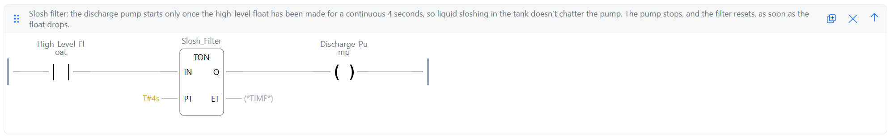

# 05: Slosh filter

**Shows:** an on-delay timer (TON) used as a filter (debounce), so a flickering input doesn't chatter an output.

## Brief

A high-level float switch and a discharge pump on a tank that rolls, so the liquid sloshes and the float flickers on and off.

- The float must be made for a continuous 4 seconds before the pump starts.
- Any drop of the float resets the timer.
- Once running, the pump runs until the float drops out.

## I/O list

| Tag | Type | Address | Description |
|---|---|---|---|
| High_Level_Float | Input | %IX4.0 | High-level float switch. TRUE when liquid is at the high level |
| Discharge_Pump | Output | %QX4.0 | Output to discharge pump contactor. TRUE runs the pump. Comes on once the float has been made continuously for 4 seconds (via Slosh_Filter), off as soon as the float drops |
| Slosh_Filter | Timer (TON) | none | 4 second slosh filter. Pump starts only after the float has been made for 4 seconds in a row. Resets when the float drops |

## Ladder

Rung comment:

1. Slosh filter: the discharge pump starts only once the high-level float has been made for a continuous 4 seconds, so liquid sloshing in the tank doesn't chatter the pump. The pump stops, and the filter resets, as soon as the float drops.

## Design notes

- One rung does the whole job. A TON's Q output stays TRUE for as long as its input stays TRUE, and drops the moment the input goes FALSE. So Q can drive the pump directly, with no seal-in. The brief's suggested two-rung version (timer, then a latched pump rung) behaves the same way.
- The timer only restarts on a FALSE to TRUE change of the float. Holding the float TRUE does nothing new; it has to drop first. That's what makes it a filter: only an unbroken 4 seconds counts.
- **Limitation, found in testing (the trap):** once the pump is running, a single brief drop of the float stops it, and it then waits a full 4 seconds before restarting. That meets the brief ("runs until the float drops out"), but on a real tank a wave could still cycle the pump. The fix would be an off-delay timer (TOF) on the stop as well, so the float has to stay down for a set time before the pump stops.

## Test record

Tested in the OpenPLC simulator.

| # | Action | Expected | Result |
|---|---|---|---|
| 1 | Float TRUE for 3 seconds, then FALSE | Pump never runs, timer resets | Pass |
| 2 | Float TRUE for 4 seconds or more | Pump starts at 4 seconds | Pass |
| 3 | Float flickers (on 2 seconds, off 1 second, on 2 seconds, off 1 second) | Pump never runs | Pass |
| 4 | Pump running, float drops | Pump stops | Pass |
| 5 | Float TRUE again straight after | Full 4 second wait again | Pass |
| Trap | Pump running, float drops briefly then comes back | Pump stops on the drop, then restarts only after another full 4 seconds | Pass (behaviour recorded in the design notes) |
