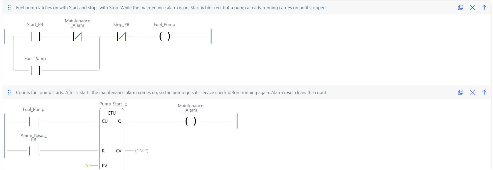

# 06: Maintenance lockout

**Shows:** an up counter (CTU) that counts pump starts, raises an alarm after a set number, and blocks further starts until the alarm is reset.

## Brief

A fuel transfer pump on a Start/Stop latch, a maintenance alarm lamp and an alarm reset button.

- Each start of the pump counts one cycle.
- After 5 starts the maintenance alarm comes on.
- The 5th run carries on, but a 6th start is blocked until the alarm is reset.
- Alarm reset clears the count and the alarm.

## I/O list

| Tag | Type | Address | Description |
|---|---|---|---|
| Start_PB | Input | %IX5.0 | Start button, TRUE when pressed |
| Stop_PB | Input | %IX5.1 | Stop button, TRUE when pressed |
| Alarm_Reset_PB | Input | %IX5.2 | Alarm reset button, TRUE when pressed |
| Fuel_Pump | Output | %QX5.0 | Output to fuel transfer pump contactor. TRUE runs the pump. Latched on by Start_PB, dropped by Stop_PB. A new start is blocked while Maintenance_Alarm is on |
| Maintenance_Alarm | Output | %QX5.1 | Maintenance alarm lamp. TRUE lights the lamp. Comes on once the fuel pump has started 5 times (Pump_Start_Counter reaches 5), off when Alarm_Reset_PB clears the count. While on, it blocks new pump starts |
| Pump_Start_Counter | Counter (CTU) | none | Counts fuel pump starts (each off-to-on). Q goes TRUE at 5, raising Maintenance_Alarm. Cleared to 0 by Alarm_Reset_PB |

## Ladder

Rung comments:

1. Fuel pump latches on with Start and stops with Stop. While the maintenance alarm is on, Start is blocked, but a pump already running carries on until stopped.
2. Counts fuel pump starts. After 5 starts the maintenance alarm comes on, so the pump gets its service check before running again. Alarm reset clears the count.

## Design notes

- **The lockout sits on the Start button only.** The normally closed Maintenance_Alarm contact is in series with Start_PB, inside the seal-in branch. The alarm comes on during the 5th run, so if the contact were across the whole rung it would stop the pump the moment the 5th start was counted. Placed on the Start branch, it can only block a new start.
- **The counter counts starts, not running time.** A CTU only counts when its CU input changes from FALSE to TRUE. The pump's run signal feeds CU, so each start adds exactly one, however long the pump runs. Test 6 proves this.
- **A CTU's Q is TRUE when the count is at or above the preset**, so the alarm stays on until the count is reset to 0, even if the pump were somehow started again.

## Test record

Tested in the OpenPLC simulator.

| # | Action | Expected | Result |
|---|---|---|---|
| 1 | Start and stop 4 times | Counter reads 4, no alarm | Pass |
| 2 | 5th start | Pump runs, counter reads 5, alarm comes on, pump keeps running | Pass |
| 3 | Stop, then try a 6th start | Pump will not start | Pass |
| 4 | Press Alarm_Reset_PB | Counter reads 0, alarm off | Pass |
| 5 | Press Start | Pump runs, counter reads 1 | Pass |
| 6 | Hold Start down, or leave the pump running a long time | Counts one, not many | Pass |
